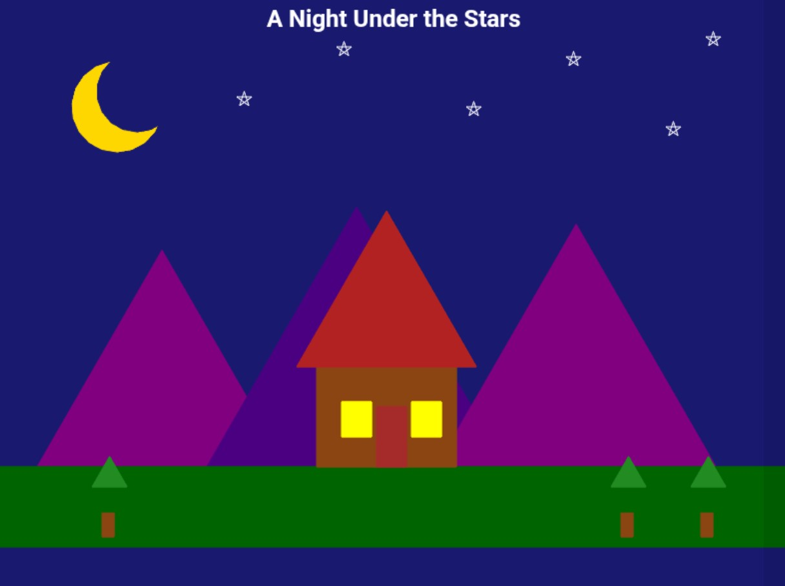

### 2. Night Under the Stars – README.md

```markdown
```
# A Night Under the Stars with Python Turtle

## Description

This project creates a simple and colourful Python program that draws a beautiful night-time scene using the `turtle` graphics library. The drawing includes a dark blue sky, a golden crescent moon, shining stars, purple mountains, green trees, and a small cabin with glowing windows.

The program demonstrates basic concepts in Python graphics, including:

* Drawing shapes (circles, rectangles, and triangles)
* Using functions to modularize code
* Using loops to create repeated patterns
* Using different colours and positions to create a night-time scene

## Code Overview

The project is structured around reusable functions:

* `draw_circle(x, y, radius, colour)` – Draws a filled circle.
* `draw_triangle(x, y, size, colour)` – Draws a filled triangle.
* `draw_rectangle(x, y, width, height, colour)` – Draws a filled rectangle.
* `draw_star(x, y)` – Draws a five-pointed star.
* `draw_tree(x, y)` – Draws a tree using rectangles and triangles.

The functions are used to create the moon, stars, mountains, cabin, and trees. Loops are used to draw multiple stars and create geometric shapes. The screenshot of the drawing is as below:



## How to Run

1. Clone or download this repository.
2. Open the project file `night_under_the_stars.py` in your Python IDE or text editor.
3. Run the program:

```bash
python night_under_the_stars.py
```
## License

This project is open-source and free to use for educational purposes.# Project1_comp115
